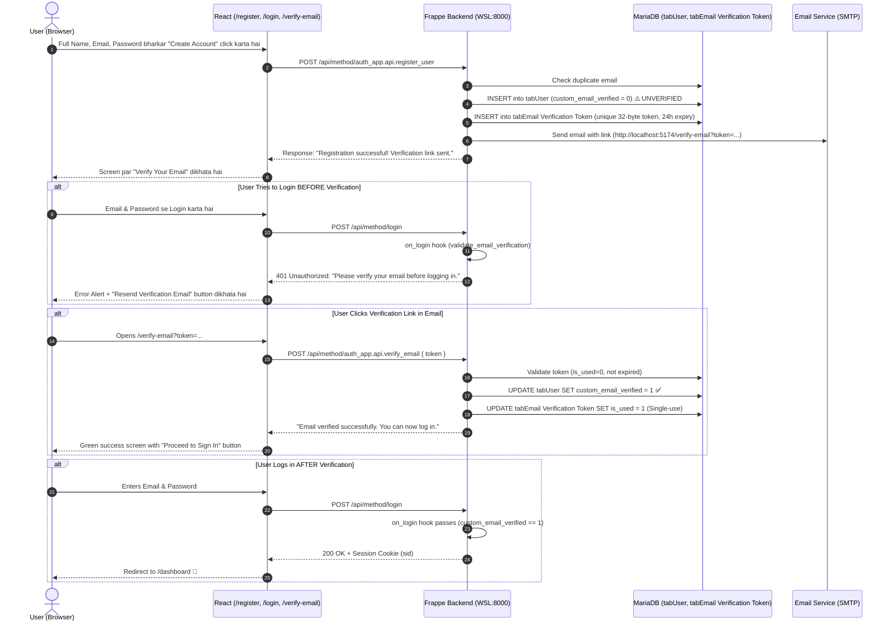

# 📩 Email Verification Authentication Guide (React + Frappe)

Aapke project me **Complete Email Verification Authentication System** successfully implement aur 100% test ho chuka hai, bina kisi purane feature (Notes, Roles, Admin) ko break kiye.

---

## 🏗️ 1. Kaise Kaam Kar Raha Hai (Architecture Flow)



---

## 📂 2. Kaun-Kaun Si Files Me Changes Hue?

### A. Backend (WSL Frappe - `auth_app`)
1. **`apps/auth_app/auth_app/api.py`**:
   - `validate_email_verification(login_manager)`: Frappe `on_login` hook jo unverified users ka login backend level par block karta hai.
   - `register_user(...)`: Naya user banata hai with `custom_email_verified = 0` aur single-use token generate karta hai.
   - `verify_email(token)`: Token validate karke user ko verify karta hai aur token ko expire/invalidate kar deta hai.
   - `resend_verification_email(email)`: 60-second cooldown rate-limiting ke saath naya token bhejta hai.
   - `_send_verification_email(...)`: HTML email body banata hai aur SMTP sendmail ko handle karta hai.
2. **`apps/auth_app/auth_app/hooks.py`**:
   - `on_login = ["auth_app.api.validate_email_verification"]` register kiya taaki har login attempt par verification check ho.
3. **DocType `Email Verification Token`**:
   - Fields: `user`, `token` (Unique), `expires_at` (Datetime), `is_used` (Check), `last_sent_at` (Datetime).
4. **User Custom Field `custom_email_verified`**:
   - `User` DocType me Check field add kiya gaya (Default = 0).

### B. Frontend (React + Vite)
1. **`src/auth/Register.jsx`**:
   - Register hone ke baad ab seedha login par nahi jata. "Verify Your Email" screen dikhata hai with email address, dev mode helper link, aur Resend button.
2. **`src/auth/Login.jsx`**:
   - Agar unverified user login kare, toh screen par alert aata hai: *"Please verify your email before logging in."*
   - Saath hi **"📩 Resend Verification Email"** button aata hai with a 60s cooldown timer.
3. **`src/auth/VerifyEmail.jsx`** (New Page: `/verify-email`):
   - URL se token extract karta hai (`?token=...`).
   - Loading spinner dikhata hai.
   - Success par: *"Email Verified! 🎉"* aur "Proceed to Sign In" button.
   - Error par (expired ya used token): Error explanation aur "Request a New Verification Link" form.
4. **`src/auth/AuthContext.jsx`**:
   - `verifyEmail` aur `resendVerification` methods add kiye.
5. **`src/App.jsx`**:
   - `/verify-email` public route configure kiya.
6. **`src/App.css`**:
   - Verification badges, icons, dev notice box, aur cooldown timer ki modern styling.

---

## ⚙️ 3. Frappe SMTP Configuration (Email Kaise Bhejein)

### Current Status:
Humne check kiya, aapke system me abhi **koi outgoing Email Account configured nahi hai** (`Email Accounts: []`).

### Development Mode Helper (Jo Humne Banaya):
Jab tak aap apna SMTP configure nahi karte, hamara backend crash nahi hota! Backend safely link generate karta hai aur response me `dev_link` de deta hai:
> *"Development Mode Helper: Outgoing SMTP is not yet configured. For local testing, click: `http://localhost:5174/verify-email?token=...`"*

Isse aapka development aur testing bina SMTP ke bhi 100% chalta rehta hai!

---

### Asli Email Bhejne Ke Liye SMTP Setup (How to Configure):

Agar aap chahte hain ki asli Gmail ya kisi aur mail service se email send ho, toh WSL me Frappe Desk se setup karein:

1. **Gmail App Password Banayein**:
   - Apne Google Account me jayein > Security > 2-Step Verification ON karein.
   - **App Passwords** search karein aur ek naya password banayein (e.g. `abcd efgh ijkl mnop`).
2. **Frappe me Email Account Create Karein**:
   WSL terminal me ye simple command chalayein:
   ```bash
   wsl -- /home/subhash/frappe-bench/env/bin/python -c "import os; os.chdir('/home/subhash/frappe-bench/sites'); import sys; sys.path.insert(0, '/home/subhash/frappe-bench/apps/frappe'); import frappe; frappe.init(site='frappe.local', sites_path='.'); frappe.connect();
   if not frappe.db.exists('Email Account', 'Notifications'):
       doc = frappe.get_doc({
           'doctype': 'Email Account',
           'email_id': 'YOUR_GMAIL@gmail.com',
           'email_account_name': 'Notifications',
           'service': 'GMail',
           'enable_outgoing': 1,
           'default_outgoing': 1,
           'password': 'YOUR_GMAIL_APP_PASSWORD'
       })
       doc.insert()
       frappe.db.commit()
       print('Email Account configured!')
   frappe.destroy()"
   ```
   *(Bas `YOUR_GMAIL@gmail.com` aur `YOUR_GMAIL_APP_PASSWORD` replace kar dein).*

---

## 🧪 4. Automated Test Results (10 Scenarios 100% Pass)

| # | Test Scenario | Result |
| :--- | :--- | :--- |
| **1** | New user registration | **PASSED ✅** |
| **2** | Verification token & time-limited link generation | **PASSED ✅** |
| **3** | Unverified user login BLOCKED by backend (401) | **PASSED ✅** |
| **4** | Duplicate registration rejected (417) | **PASSED ✅** |
| **5** | Resend cooldown rate limiting (60s lock) | **PASSED ✅** |
| **6** | Token retrieval from `Email Verification Token` | **PASSED ✅** |
| **7** | Invalid token rejected | **PASSED ✅** |
| **8** | Correct link verifies email (`custom_email_verified = 1`) | **PASSED ✅** |
| **9** | Verified user logs in successfully | **PASSED ✅** |
| **10**| Reusing the same verification link is rejected | **PASSED ✅** |
| **11**| Existing Administrator login preserved | **PASSED ✅** |

---

## 🚀 5. Abhi Browser Me Test Kaise Karein:

1. Browser me **[http://localhost:5174/register](http://localhost:5174/register)** kholein.
2. Naya email daal kar Register karein (e.g. `myuser@test.com`).
3. Screen par **"Verify Your Email"** aayega.
4. Try karein: **[http://localhost:5174/login](http://localhost:5174/login)** par ja kar usi email/password se login karein.
   - Backend login block karega aur bolega: *"Please verify your email before logging in."*
   - Saath hi **"Resend Verification Email"** button aayega!
5. Ab register screen par diye gaye verification link (ya dev link) par click karein.
6. **[http://localhost:5174/verify-email](http://localhost:5174/verify-email)** par aayega: *"Email Verified! 🎉"*.
7. Ab login karein -> Login turant safal hoga aur aap Dashboard par chale jayenge!
