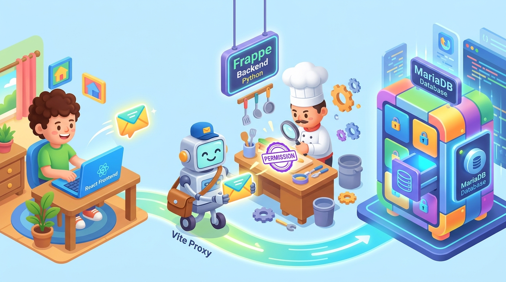

# 🎈 Zero Se End Tak: Ek Aasan Kahani (Baccho Ki Tarah Samjhein)

> Agar aapko coding ya computer science ka kuch bhi nahi pata, toh bhi **5 minute me aapko sab kuch crystal clear samajh aa jayega**!

---

## 🖼️ Pehle Ye Picture Dekhein (Pure Project Ka Naksha)



Is picture me hamare project ke **4 Main Heroes** hain:
1. 👦 **React Frontend (Left)**: Ek bacha laptop par baithkar form bhar raha hai.
2. 🤖 **Vite Proxy (Middle)**: Ek robot dakiya jo chhitthi lekar dodh raha hai.
3. 👨‍🍳 **Frappe Backend (Center)**: Ek Master Chef jo magnifying glass se stamp check kar raha hai.
4. 🗄️ **MariaDB Database (Right)**: Ek badi digital tijori jisme har user ka alag-alag locker hai.

---

## 🌟 Hamare 4 Heroes Kaun Hain Aur Kya Karte Hain?

### 👦 Hero 1: React Frontend (The Face / Chehra)
- **Ye kya hai?** Jo kuch bhi aapko screen par apni aankhon se dikhta hai — buttons, text boxes, colors, dark mode — wo sab **React** hai.
- **Kahan chalta hai?** Aapke browser me (`http://localhost:5174`).
- **Iska kaam kya hai?** User se form bharwana (jaise Name, Email, Password, Note Title).

---

### 🤖 Hero 2: Vite Proxy (The Robot Dakiya / Postman)
- **Ye kya hai?** Ek bridge (pul) jo Windows aur Linux ke beech me khada hai.
- **Iska kaam kya hai?**
  - Aapka React chal raha hai **Windows** par (`localhost:5174`).
  - Aapka Backend chal raha hai **Linux/WSL** par (`192.168.29.171:8000`).
  - Agar browser direct doosre computer ko call karega, toh browser ko lagta hai ki koi hacker chori kar raha hai (ise **CORS Error** kehte hain).
  - Isliye hamara Robot Dakiya beech me khada hokar request ko chupke se Windows se Linux tak pahuncha deta hai.

---

### 👨‍🍳 Hero 3: Frappe Backend (The Master Chef & Chowkidar)
- **Ye kya hai?** Python me likha hua dimag (Brain) jo WSL Ubuntu ke andar baitha hai.
- **Iska kaam kya hai?**
  - Ye har aane wali chhitthi ko check karta hai.
  - Password verify karta hai.
  - Sabse zaroori: **Ye check karta hai ki koi doosre ka note chori toh nahi kar raha!**

---

### 🗄️ Hero 4: MariaDB Database (The Giant Safe Locker / Tijori)
- **Ye kya hai?** Ek permanent digital tijori jo WSL Linux ke hard drive me data store karti hai.
- **Database Ka Naam**: `_0ce39c59cf7548f4`.
- **Table Ka Naam**: **`tabUser Note`** (jisme aapke notes rakhe hain) aur **`tabUser`** (jisme accounts rakhe hain).
- **Computer band hone par kya hoga?** Kuch nahi! Data hard drive me save rehta hai, kabhi gayab nahi hota.

---

## 🎬 Zero Se End Tak Ka Pura Flow (Step-by-Step Kahani)

Aaiye dekhte hain jab aap website par aate hain toh asliyat me kya hota hai:

```
[ Bacha ] ──(1. Form Bhara)──▶ [ React UI ]
                                    │
                               (2. Chhitthi Bheji)
                                    ▼
                             [ Robot Dakiya (Vite Proxy) ]
                                    │
                               (3. Linux Ko Diya)
                                    ▼
                             [ Master Chef (Frappe) ]
                                    │
                               (4. Check Kiya & Chabi Lagayi)
                                    ▼
                             [ Digital Tijori (MariaDB) ]
                                    │
                             (5. Data Hamesha Ke Liye Save!)
```

---

### 📍 Scene 1: Naya Account Banana (Register)
1. Aapne form me likha: Name = "Subhash", Email = "subh@gmail.com", Password = "123".
2. **React** ne check kiya: Password khali toh nahi hai? Sab theek.
3. Robot Dakiya chhitthi lekar **Frappe Chef** ke paas gaya.
4. Chef ne check kiya: *"Kya subh@gmail.com naam ka bacha pehle se registered hai?"*
   - Agar nahi hai, toh Chef ne **MariaDB Tijori** ke `tabUser` table me Subhash ka naam darj kar diya.
   - Password ko secret code (Hash) me badal kar save kiya taaki koi chura na sake.
5. Chef ne bola: *"Badhai ho! Account ban gaya."* Screen par Green alert aa gaya!

---

### 📍 Scene 2: Login Karna Aur "Stamp" Milna (Authentication)
1. Aapne wahi Email aur Password daala aur "Sign In" dabaya.
2. Chef ne Tijori me dekhkar password milaya — match ho gaya!
3. Ab Chef ne browser ke haath par ek **Invisible Stamp** laga diya:
   👉 **`sid=abc123xyz`** *(Is stamp ko **Session Cookie** kehte hain).*
4. **Is stamp ka fayda kya hai?**
   Ab jab bhi bacha koi page kholega ya refresh karega, browser ye stamp Chef ko dikha dega. Bacha bina dobara password daale logged in rahega!

---

### 📍 Scene 3: Note Banana (Create Note)
1. Subhash ne dashboard par **"➕ New Note"** dabaya.
2. Title likha: **"day 1"**, Content likha: **"Mera pehla private note"**.
3. Create button dabate hi request Chef ke paas gayi.
4. Chef ne pehle stamp dekha: *"Ye chhitthi kiski hai? Acha, haath par Subhash ka stamp hai!"*
5. Chef ne note ke upar khud likh diya: `note_user = "subh@gmail.com"`.
6. Chef ne **MariaDB** tijori ka locker khola (`tabUser Note`) aur note ko andar rakh kar taala laga diya!

---

### 📍 Scene 4: Chori Rokna (The Magic of Privacy 🔒)
Ye is project ka **sabse bada hero feature** hai!

Maan lijiye do bache hain:
- **Bacha 1 (Subhash)**: Iska note ID hai `i43m765a2u`.
- **Bacha 2 (Rahul)**: Ek doosra user.

1. Rahul ne chalaki dikhayi! Usne URL me zabardasti type kiya:
   `http://localhost:5174/notes/i43m765a2u/edit` (Subhash ka note kholne ki koshish ki).
2. Robot Dakiya ye request lekar Chef ke paas gaya.
3. **Chef ne magnifying glass nikala:**
   - Note ka asli malik kaun hai? -> **Subhash**.
   - Maang kaun raha hai? Stamp par naam hai -> **Rahul**.
4. Chef gussa ho gaya! 😡
   Chef ne chillakar bola: **"403 Forbidden! You do not own this note!"**
5. Tijori ka darwaza band hi raha! Note ka ek lafz bhi screen par nahi aaya.
6. Screen par bada sa tala 🔒 aur **"Access Denied"** banner aa gaya!

---

### 📍 Scene 5: Principal Sir (Admin User)
- School ke Principal (Administrator) ke paas **Master Key** hoti hai.
- Jab Admin login karta hai, toh wo **`/admin/notes`** par jakar dekh sakta hai ki school me kis-kis bache ne kitne notes banaye hain, aur kis bache ka kaunsa email hai.
- Lekin aam bache (Normal Website Users) kabhi Principal ke room me nahi ghus sakte!

---

## 🎯 30-Second Summary (Agar Sir Poochein Toh Ye 4 Linein Bolein)

1. *"Sir, **React** hamari dukaan ka front counter hai jahan user form bharta hai."*
2. *"**Vite Proxy** hamara delivery boy hai jo browser ke CORS error ko rokta hai."*
3. *"**Frappe (Python)** hamara security guard aur chef hai jo check karta hai ki kaun login hai aur kisko kya dikhana hai."*
4. *"**MariaDB** hamari digital tijori hai jisme saara data `tabUser Note` table me hamesha ke liye save rehta hai."*
5. *"User A ka note User B kabhi nahi dekh sakta kyunki Frappe backend har request par user ka session stamp check karta hai!"*
